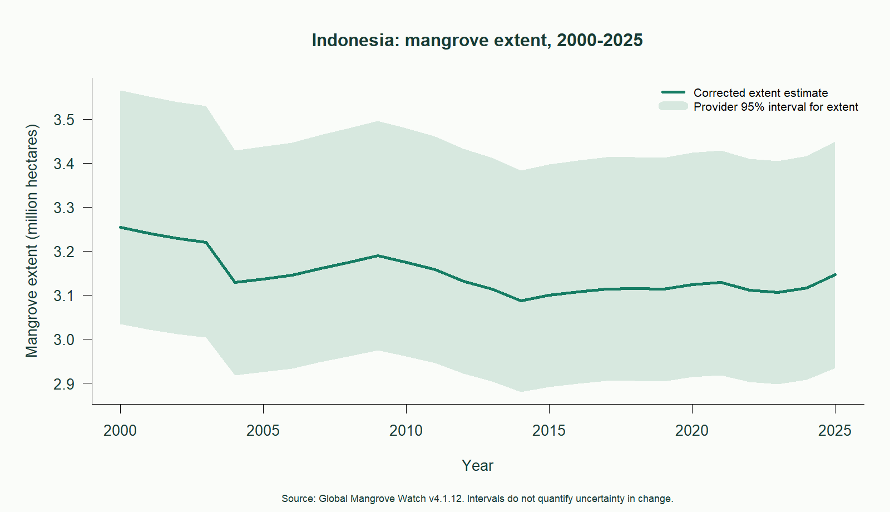
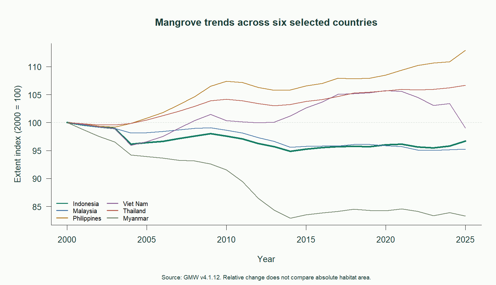
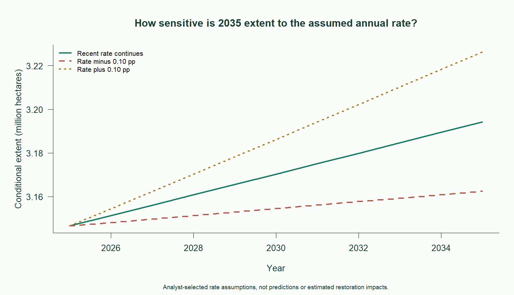

# Indonesia Mangrove Trends

A reproducible R research pilot examining historical mangrove extent, regional comparisons, and sensitivity to assumed future annual rates.

**Main result:** Indonesia's corrected estimated extent decreased by **3.29% from 2000 to 2025**, while its **2015-2025 compound annual rate was +0.151%**. The different periods tell different stories. These descriptive results do not establish a policy's impact or statistical significance.



## Run in VS Code

Open this folder in VS Code, choose **Terminal > New Terminal**, and run:

```powershell
powershell -ExecutionPolicy Bypass -File .\run.ps1
```

This execution policy option applies only to the new PowerShell process. It does not change the machine's saved settings. The launcher uses Rscript from PATH or this computer's R 4.6.1 installation. Update the fallback path in `run.ps1` on a different computer.

Alternatively, with Rscript on PATH:

```powershell
Rscript --vanilla scripts/02_country_analysis.R
```

The only required package is `readxl`, installed into a project-local `.r-library` if needed. Tested with R 4.6.1 and readxl 1.6.0. The optional VS Code R extension helps with editing but is not needed to run the script.

Open **reports/research_brief.html** in a browser. Keep reports and outputs together so its images load. `START_HERE.md` explains the deadline workflow and key methods to review.

## Research question

How has Indonesia's estimated mangrove extent changed since 2000, how does its relative trajectory compare with five selected regional countries, and how sensitive are conditional 2035 values to assumed annual rates?

## Analytical workflow

1. Verify the original workbook against the publisher's MD5 checksum.
2. Read country estimates and lower/upper 95% intervals from three sheets.
3. Remove blank/footer rows, reshape year columns to long format, and join by country-year keys.
4. Validate unique identifiers, expected years, finite nonnegative areas, complete joins, and ordered intervals.
5. Calculate net change and compound annual rates. Normalize six selected countries to a 2000 index of 100.
6. Compare deterministic scenarios using the 2015-2025 annual rate and that rate plus or minus 0.10 percentage points.
7. Generate charts, numeric tables, a research brief, and environment logs from one R script.





## Outputs

- `reports/research_brief.html`: question, findings, methods, charts, and limitations.
- `outputs/tables/indonesia_trend.csv`: annual focal estimates, source intervals, and calculated change.
- `outputs/tables/peer_comparison.csv`: indexed country comparison.
- `outputs/tables/scenario_assumptions.csv`: explicit annual-rate assumptions.
- `outputs/tables/scenarios.csv`: conditional scenario paths.
- `outputs/tables/key_results.csv`: unrounded headline calculations.
- `data/processed/country_extent_tidy.csv`: source countries and years in tidy form.

## Source and attribution

Bunting et al. (2026). *Global Mangrove Watch: Timeseries of Mangrove Extent*, version **4.1.12**. [Pinned dataset and full author list](https://zenodo.org/records/21346457). [CC BY 4.0](https://creativecommons.org/licenses/by/4.0/). Accessed October 21, 2026.

The original country-statistics workbook is unchanged. Its MD5 is `30800462dcd06a184df33aa66e0337a2`. Derived tables reshape and subset its estimates, and derived charts visualize them. Areas are hectares and already contain the provider's accuracy-based correction; this analysis does not apply that correction again. The provider README is saved with the input.

## Limitations

- National totals cannot identify restoration sites or separate gross habitat gain and loss.
- Provider intervals describe extent at each date. An interval for change requires information on errors correlated across years. This pilot does not claim statistical significance.
- Temporal filtering and infilling mean annual estimates are not necessarily independent observations. Earlier source years have greater observation constraints.
- The comparison uses six deliberately selected countries, not a complete Southeast Asian ranking.
- Scenarios are sensitivity calculations, not predictions, probabilities, or estimated restoration benefits. Rate offsets are analyst assumptions.
- No carbon, biodiversity, household, or field observations are analyzed.

## Next phase

Map gross change in one small Indonesian coastal area, inspect observation quality, and integrate ecological and community evidence before developing site-screening indicators. `PROJECT_BRIEF.md` records the longer-term roadmap. Optional scripts `00_setup.R` and `01_project_check.R` concern that future spatial work and are not required for this country-level pilot.
